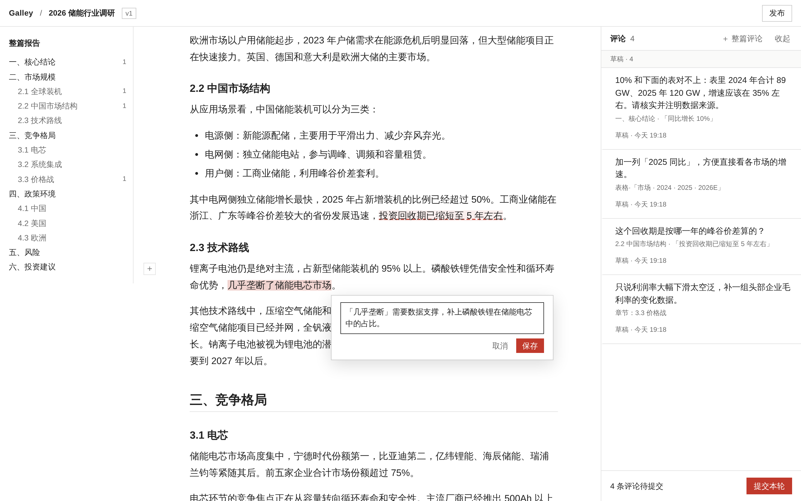
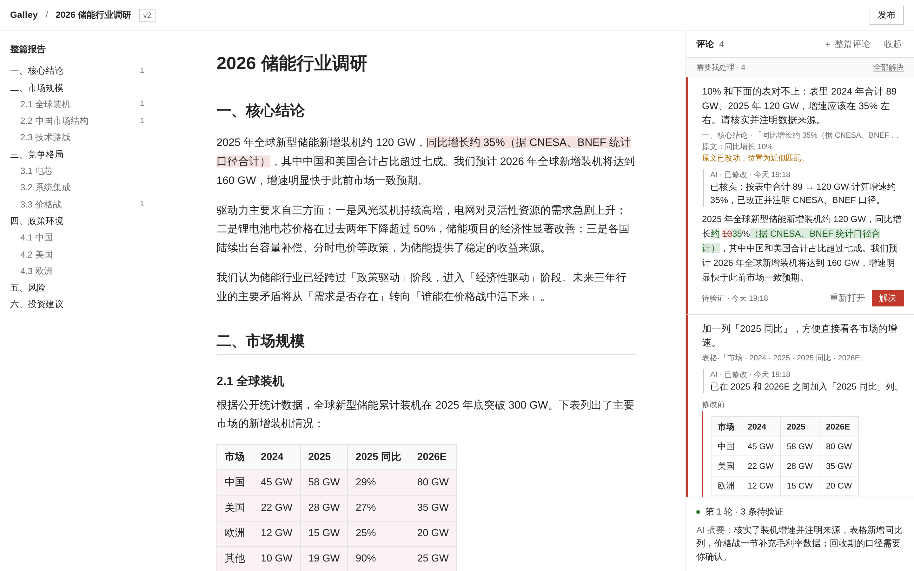
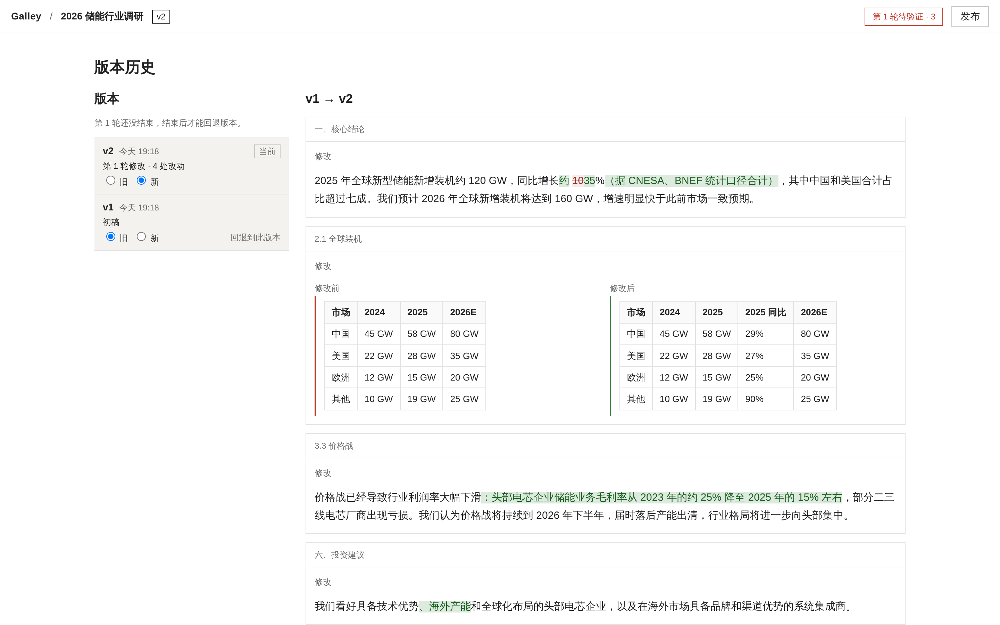
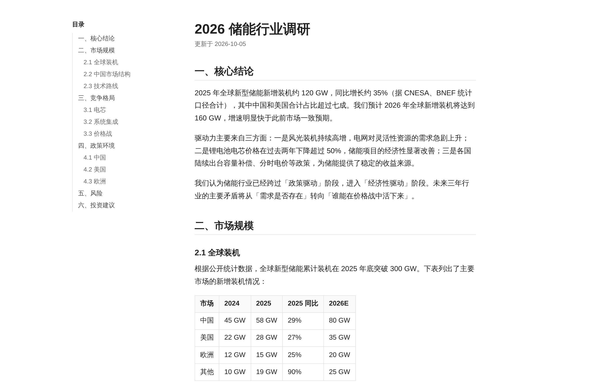

<p align="center">
  
</p>

<h1 align="center">Galley</h1>

<p align="center"><strong>让 AI 按你的评论改报告，并且看清它改了什么。</strong></p>

<p align="center">
  <a href="#功能">功能</a> ·
  <a href="#安装">安装</a> ·
  <a href="#使用">使用</a> ·
  <a href="LICENSE">MIT</a>
</p>

让 AI 写一份长报告很快，改到能交出去却很慢。Claude Artifacts 虽然也能留评论，但在评论的处理和替换上不够精准：

- 评论交给 AI 后，有的被忽略，有的改偏了，很难确认每一条都处理到位；
- 只想改一句，整段甚至别的地方也可能跟着变，改完还看不出具体动了哪里；
- 报告只能用 Claude 写，存在 Claude 里。

Galley 让你像批改文稿一样改 AI 的报告。

- 评论写在原文上，可以精确到一句话、一段、一张表或一整章。攒成一轮交给 AI 后，AI 必须逐条回复，漏一条整轮都不会生效；
- 每条评论下都有逐字对比，评论没要求的改动单独列出来，由你确认或改回去；
- 任何支持 MCP 的 AI 都能接入，报告存在你自己的服务器上，定稿后发布一个不含评论和修订痕迹的只读链接。



| 验证 AI 的修改 | 对比版本 | 发布干净的页面 |
| --- | --- | --- |
| [](docs/screenshots/verify.png) | [](docs/screenshots/history.png) | [](docs/screenshots/share.png) |
| 每条评论下显示 AI 的回复和逐字对比，逐条解决或重新打开。 | 任选两个版本逐块对比，可以回退。 | 读者看到的是纯净页面，没有评论、修订痕迹和脚本。 |

## 功能

- **评论写在原文上**：选中的文字（可以跨段落）、整段、表格或图表、整章、整篇都能评论。
- **按轮交给 AI**：评论攒成一轮一起提交。AI 必须逐条回复（已修改、已回答或反问），结果整体提交，不会只改一半；只有你能把评论标为解决。
- **改了什么一目了然**：每条评论下有 AI 的回复和逐字对比；评论没要求的改动单独列出，可以确认或改回去。
- **评论跟着文字走**：文字改了或挪了位置，评论还在原处；原文被删掉的评论会标出来，不会丢。
- **版本历史**：任选两个版本对比，可以回退。
- **干净的分享链接**：发布当时版本的快照，不含评论、修订痕迹和脚本；重新发布沿用原链接，停用后失效。
- **图表和图片**：Mermaid 和 SVG 在服务端渲染，支持上传图片和外链图片，分享页里也能正常显示。
- **接入任何 AI**：通过 MCP 或 HTTP 接口接入，Claude Code、Codex、Droid、Devin 等都能用。

## 安装

### Docker

```sh
git clone https://github.com/cosmtrek/galley.git && cd galley
docker compose up -d --build
docker compose logs galley   # 首次启动会打印生成的密码
```

打开 http://localhost:7860/app 。数据保存在 `galley-data` 卷里。升级时 `git pull` 后再执行一次 `docker compose up -d --build`。

### 从源码构建

需要 Rust 1.99+ 和 Node 24（pnpm 通过 corepack 提供）。界面在编译时嵌入程序，所以要先构建界面：

```sh
cd web && corepack pnpm install && corepack pnpm build && cd ..
cd server && cargo build --release && cd ..
./server/target/release/galley
```

### 配置

通过环境变量配置（Docker 下写在 [`docker-compose.yml`](docker-compose.yml) 的 `environment` 里）：

| 变量 | 默认值 | 说明 |
| --- | --- | --- |
| `GALLEY_PUBLIC_URL` | `http://<addr>` | 人和 AI 访问 Galley 的地址，分享链接据此生成。设为 `https://` 地址时同时启用安全 Cookie |
| `GALLEY_PASSWORD` | 自动生成 | 登录密码 |
| `GALLEY_AGENT_TOKEN` | 自动生成 | 给 AI 用的 Bearer token |
| `GALLEY_ADDR` | `127.0.0.1:7860`（Docker 下为 `0.0.0.0:7860`） | 监听地址 |
| `GALLEY_DATA` | `./data`（Docker 下为 `/data`） | 数据库、上传文件和生成的密钥 |

没有设置的密码和 token 会在首次启动时生成，并保存到 `<data>/secrets.json`。Galley 只提供 HTTP；要从其他机器访问，请放在带 TLS 的反向代理后面，并把 `GALLEY_PUBLIC_URL` 设为对应的 `https://` 地址。

## 使用

1. **接入 AI。** 报告列表为空时页面上直接给出接入步骤；已有报告时在「添加报告」→「让 AI 发过来」里展开「接入方法 / 换个客户端」。里面有 Claude Code、Codex、Droid、Devin 的接入命令，已填好你的 token。例如：

   ```sh
   claude mcp add --transport http galley http://localhost:7860/mcp \
     --header "Authorization: Bearer <GALLEY_AGENT_TOKEN>"
   ```

   不支持 MCP 的 AI 可以用 HTTP 接口：`GET /api/pending` 列出等待处理的轮次，`GET /api/rounds/<id>/packet?format=md` 返回一轮的评论、上下文和处理要求，处理结果用 `POST /api/rounds/<id>/result` 提交，轮次之外推送新版本用 `POST /api/reports/<id>/versions`。两者都可以只提交改动（`edits`），不必传完整 Markdown，写法见评论包里的处理要求。图片用 `POST /api/reports/<id>/assets?name=fig.png` 上传（请求体是文件原始内容），在报告里写成 ``。

2. **添加报告。** 让 AI「把这份报告发到 Galley」，或者点「添加报告」→「手动导入」，粘贴 Markdown 或拖入 `.md` 文件（「填入示例报告」可以载入示例）。
3. **写评论。** 选中文字评论；鼠标移到段落或标题左侧，点评论图标评论整段或整章。用一句话说清要改什么，包括是否适用于全文。
4. **提交本轮。** 点「提交本轮」，再点「复制指令」，把指令粘贴给 AI。等待期间可以继续写下一轮的草稿。
5. **验证。** AI 处理完后，侧栏逐条显示它的回复和改动：解决、重新打开，或回答 AI 的反问。「评论之外的改动」逐条确认或改回去。重新打开的评论进入下一轮。
6. **发布。** 在「发布」页发布当前版本并分享链接。

## 许可证

[MIT](LICENSE)
